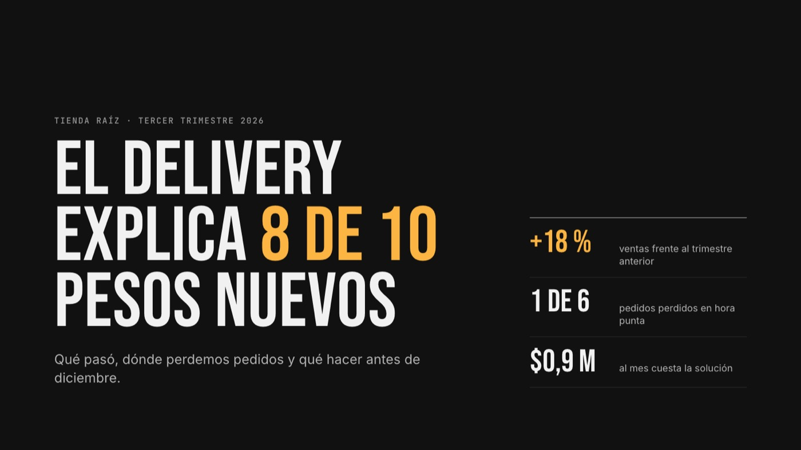
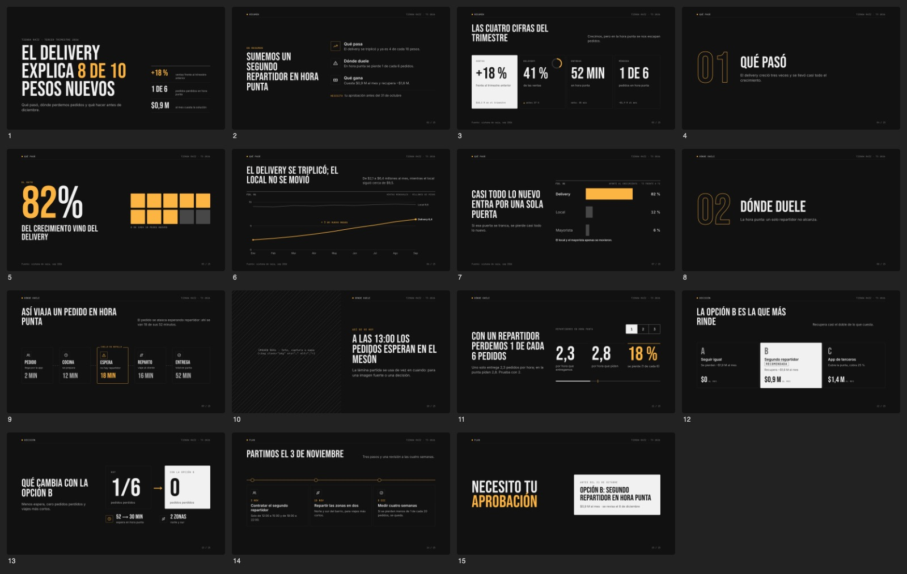
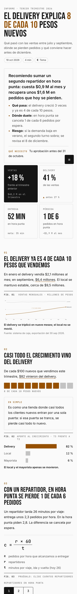
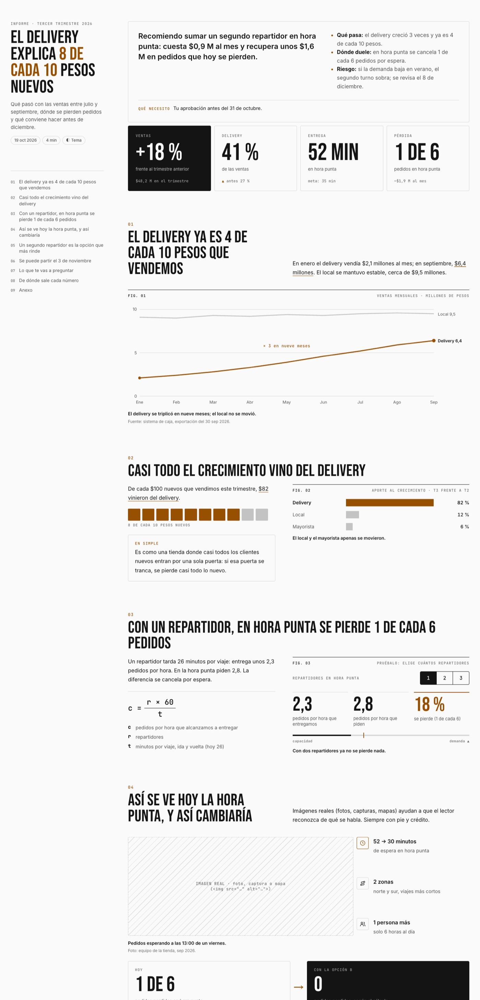
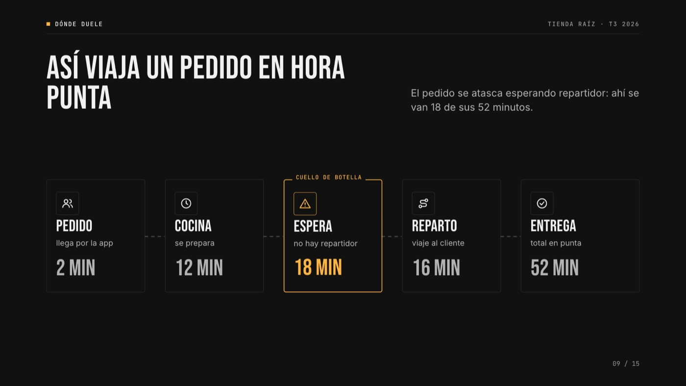
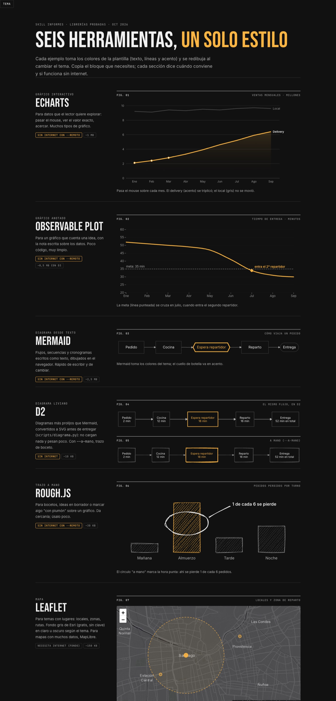

# informes

**Una skill para agentes de IA que hace informes y presentaciones que se entienden a la primera.**

Le pides a tu agente "hazme un informe de…" o "arma una presentación para…" y la skill lo guía de principio a fin: entender para quién es, decir la conclusión primero, elegir el gráfico o la imagen correcta para cada idea, diseñar con un estilo cuidado, revisar el resultado en escritorio y celular, y entregar un solo archivo HTML que se abre en cualquier navegador.



## Qué hace

- **Informes y presentaciones en HTML:** un solo archivo, sin instalar nada para verlo. Funciona sin internet y se puede exportar a PDF.
- **Contenido antes que diseño:** brief, idea principal en una frase, guion de títulos que son afirmaciones ("las ventas crecieron 12 %", no "Ventas"), preguntas del lector anticipadas y cifras que dicen de dónde salen.
- **Adapta el largo y el nivel:** corto o extenso; simple, ejecutivo o técnico. "Explícalo simple" se toma en serio.
- **Visual para cada idea:** gráficos, pictogramas, antes y después, flujos, líneas de tiempo, simuladores, imágenes reales y diagramas. Más imágenes, menos muros de texto.
- **Presentaciones animadas:** elementos que entran en cascada, líneas que se dibujan, barras que crecen y cifras que cuentan desde cero.
- **Presentaciones narradas:** una voz (gratis, de Microsoft Edge) presenta el deck sola y destaca cada cosa justo cuando la nombra, con subtítulos palabra por palabra.
- **Panel de opciones** en cada presentación: narrador, controles, resaltados, barra de progreso con miniaturas, tema claro u oscuro, color del acento y pantalla completa.
- **Revisión automática:** capturas de escritorio y celular más avisos de desbordes, texto chico, contraste bajo y láminas con espacio vacío.
- **Estilo:** el que pidas; si no dices, el del proyecto del que se habla (su app, su web, su marca); si no hay, un estilo propio en blanco y negro con un solo acento.

| Presentación (15 láminas de ejemplo) | Informe en celular |
|---|---|
|  |  |



## Instalación

La skill sigue el formato de [Agent Skills](https://github.com/anthropics/skills): un `SKILL.md` con las instrucciones, más guías, plantillas y scripts. Para Claude Code:

```bash
git clone https://github.com/Inverosimil/skill-informes.git ~/.claude/skills/informes
```

Desde ese momento, cualquier pedido de informe o presentación la activa sola. Para forzarla: `/informes` o "usa la skill informes". Otros agentes que lean skills pueden usarla igual, apuntándolos a `SKILL.md`.

### Requisitos

| Para | Necesitas |
|---|---|
| Ver los informes | solo un navegador |
| Revisión automática y PDF (`capturas.mjs`) | Node 22 o más nuevo y Google Chrome |
| Empaquetar en un archivo (`empaquetar.py`) | Python 3 (Pillow opcional, para comprimir imágenes) |
| Narración con voz (`narrar.py`) | Python 3, `ffprobe` (de ffmpeg) e internet al generar; instala `edge-tts` solo la primera vez |
| Diagramas D2 (`diagrama.py`) | [`d2`](https://d2lang.com) |

## Cómo se usa

Pídelo como se lo pedirías a una persona:

> Hazme un informe corto con estos gastos de la cafetería. Quieren saber en qué se va la plata y qué podrían recortar; no saben nada de números.

> Arma una presentación de 8 láminas sobre el estado del proyecto para el directorio del jueves.

> Hazme una presentación narrada para entender en qué está este proyecto; la voy a ver solo.

El agente sigue ocho pasos: brief, mensaje, guion, visuales, diseño, construcción desde la plantilla, revisión con capturas y entrega.

### Presentaciones narradas

Cada lámina lleva su guion hablado, con marcas que dicen qué destacar y cuándo:

```html
<aside class="voz">
¿Por qué el plan B? Mira estas barras.
[foco .bars>div:nth-child(2)] Con dos repartidores casi no se pierde ningún pedido. Ese es el punto dulce.
</aside>
```

```bash
python3 scripts/narrar.py deck.html deck.narrado.html            # voz Catalina (Chile)
python3 scripts/narrar.py deck.html deck.narrado.html --voz jorge
python3 scripts/empaquetar.py deck.narrado.html final.html --remoto
```

Al abrirla, la tecla `N` (o el panel de opciones, con `O`) enciende el narrador. `--voz` acepta cualquier voz de Edge (`edge-tts --list-voices`). Detalle en [`references/html-deck.md`](references/html-deck.md), sección "Narración".



### Librerías de apoyo

Para lo que las plantillas no cubren hay ejemplos probados con el mismo estilo: ECharts y Observable Plot (gráficos), D2 y Mermaid (diagramas), rough.js (trazo a mano), Leaflet (mapas) y Scrollama (informes que se cuentan al bajar). Guía en [`references/librerias.md`](references/librerias.md); ejemplos funcionando en [`assets/librerias.html`](assets/librerias.html).



## Qué trae

```
SKILL.md                 el proceso en 8 pasos (lo que lee el agente)
references/              guías: comunicar, visuales, diseño, deck, informe, librerías, marcas, revisión
assets/                  plantillas: deck.html, informe.html, librerias.html
scripts/
  capturas.mjs           capturas de escritorio y celular, avisos y PDF
  empaquetar.py          todo en un solo HTML (imágenes, fuentes y librerías incrustadas)
  narrar.py              genera la voz del guion y la incrusta
  diagrama.py            diagrama D2 → SVG con los colores de la plantilla
evals/                   un caso de prueba de la skill (formato de skill-creator)
docs/                    imágenes de este README
```

## Tu propia marca

Si trabajas para una organización con marca propia, crea una skill de marca aparte (colores, tipografía, logos y ejemplos) y descríbela en [`references/marcas.md`](references/marcas.md): la marca decide lo visual y esta skill sigue decidiendo el contenido.
